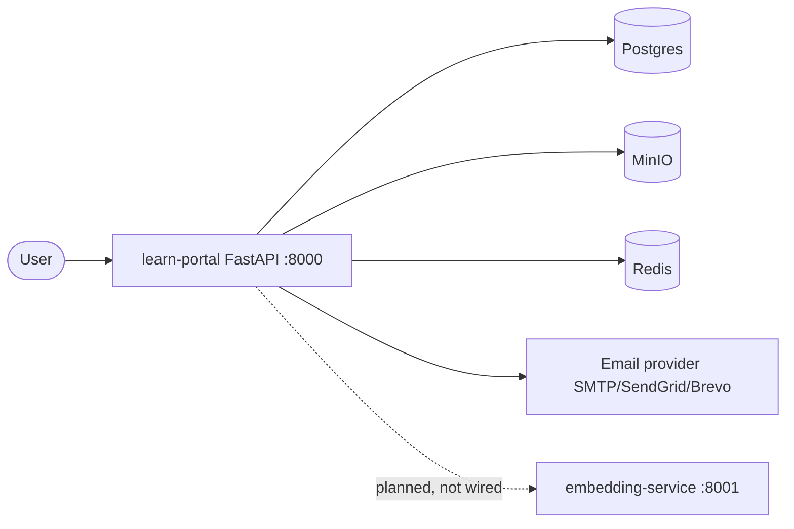
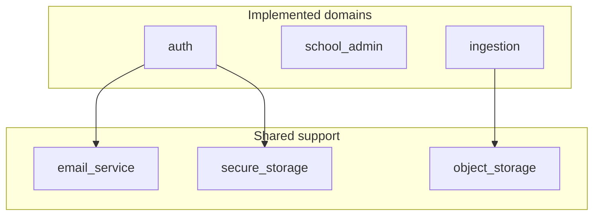
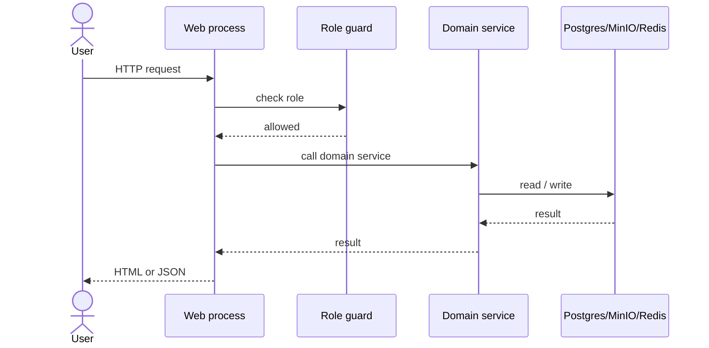
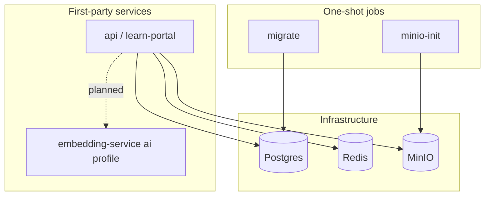
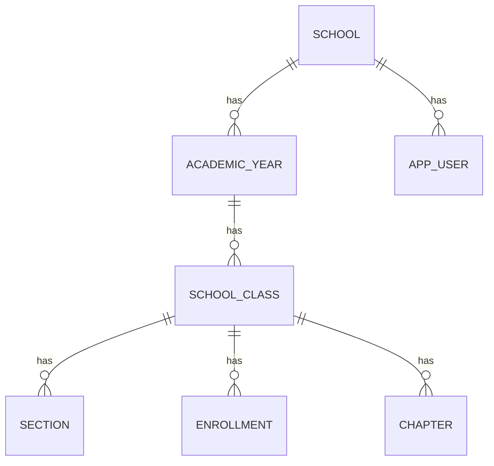

<!-- Worked example: the canonical greenfield-style SAD for Learn Portal, written in ASD-STE100
     Simplified Technical English. Note the style: short active sentences, one claim each, plain
     words, lists for sequences. The provenance banner and Appendix A carry the reverse-engineered
     truth so the body reads greenfield-clean. Built from the docs/discovery/ evidence artifacts. -->

---
title: Software Architecture Document — Learn Portal
version: 1.0
date: 2026-10-14
status: draft
authors: [discovery phase (BheemBhai)]
approvers: []
---

> **Provenance.** The BheemBhai Discovery phase recovered this document from the source code. It
> did not exist before the build. The document reads as a greenfield architecture document, but it
> describes a system that already exists. Confidence changes by section. The source-cited evidence
> is in `docs/discovery/`. Read **Appendix A — Evidence & Provenance** for what is observed, what
> is inferred, and what is uncertain.

# Software Architecture Document — Learn Portal

## Revision history
| Version | Date | Author | Change |
|---------|------|--------|--------|
| 1.0 | 2026-10-14 | discovery | Initial recovery |

## 1. Introduction

### 1.1 Purpose
This document describes the architecture of Learn Portal. An engineer reads it to understand the
system before a change.

### 1.2 Scope
This document covers the two first-party services and their shared infrastructure. It does not
cover the opt-in AI services in detail, because those services are not complete.

### 1.3 Audience
Engineers, technical leads, and security reviewers read this document.

### 1.4 Definitions and acronyms
| Term | Definition |
|------|------------|
| School | The single tenant of one deployment. |
| Chapter | A unit of uploaded content. The system parses it and shows a preview. |
| JWT | JSON Web Token. The system uses it for authentication. |

### 1.5 References
- `docs/discovery/_system/architecture.md`
- `docs/discovery/_system/integration-map.md`
- `docs/discovery/_system/security-posture.md`

## 2. Architecture goals and constraints

### 2.1 Goals
The system serves a school learning portal. It manages users, academic structure, and chapter
content. It prepares for AI-assisted learning features.

### 2.2 Constraints
The system runs with Docker Compose. One deployment serves one school. The team uses Python and
FastAPI.

### 2.3 Quality attributes
- Security: the system protects user accounts and school data.
- Maintainability: the code uses one convention for each domain module.
- Scalability: the current design runs as a single process. It does not scale horizontally yet.

## 3. Stakeholders and concerns
| Stakeholder | Concern | Addressed in |
|-------------|---------|--------------|
| School admin | Manage years, classes, and users | §6.1 |
| Engineer | Change a domain safely | §6.3, §8 |
| Security reviewer | Auth and secrets | §8.1 |

## 4. System context
Learn Portal is a web application. It serves two user surfaces from one process: server-rendered
HTML pages and a JSON API. It stores data in Postgres. It stores chapter files in MinIO. It sends
email through one of three providers. A separate embedding service is planned but not wired.

_Source: `docs/discovery/_system/integration-map.md`. Dashed = planned, not wired._

## 5. Architecturally significant requirements
1. The system authenticates every user with one scheme.
2. The system isolates one school per deployment.
3. The system stores chapter files outside the database.
4. The system keeps the AI feature path optional.

## 6. Architecture views

### 6.1 Logical view
The application is a modular monolith. One FastAPI process hosts 15 domain modules. Three domains
are complete: `auth`, `school_admin`, and `ingestion`. Twelve domains are placeholders. Three
shared support modules provide email, object storage, and secure storage. Each support module uses
a loader and a plugin.

_Source: graphify graph + `docs/discovery/learn-portal/structure-map.md`. The 12 placeholder domains have no routes._

### 6.2 Runtime / process view
The system runs one web process. A request follows these steps:
1. The web process receives the request.
2. A per-route guard checks the user role.
3. The handler calls its domain service.
4. The service reads or writes Postgres, MinIO, or Redis.
5. The handler returns HTML or JSON.

_Source: graphify path + `docs/discovery/learn-portal/api-surface.md`._

### 6.3 Development view
The code uses one convention for each domain. Each domain has a `router.py`, one or more service
modules, and a `models.py`. The project has no shared `core` package. The project has no enforced
layer separation.

### 6.4 Deployment view
Docker Compose runs the system. The default profile starts the API, Postgres, Redis, and MinIO. A
one-shot job runs the database migration before the API starts. A second one-shot job creates the
MinIO bucket. The `ai` profile starts the embedding service, Ollama, Prefect, Langfuse, and
MailHog. The `ai` profile is not complete.

_Source: `docker-compose.yml` + `docs/discovery/_system/integration-map.md`._

### 6.5 Data view
Postgres is the only database. It holds 14 tables. The application generates string UUID primary
keys. Alembic owns the schema. The schema declares no indexes. MinIO holds the chapter files.

_Source: `docs/discovery/learn-portal/data-model.md` — 14 tables total; key relationships shown._

## 7. Interfaces and integrations
- The API exposes 80 routes: 40 HTML routes and 38 JSON routes, plus `/health` and `/`.
- The system calls Postgres, MinIO, and Redis with synchronous SDK calls.
- The system sends email through SMTP, SendGrid, or Brevo. The configuration selects the provider.
- The system plans a call to the embedding service. This call is not wired.

## 8. Cross-cutting concerns

### 8.1 Security (authentication and authorization)
The system uses one JWT and bcrypt scheme. It applies the scheme per route with three guards. It
does not use global middleware. Warning: five of 24 web POST routes have no CSRF check.

### 8.2 Configuration
One settings module holds all configuration. Every setting has a default. The application starts
with no `.env` file. Docker Compose overrides each connection value.

### 8.3 Logging and observability
Each service exposes a `/health` route. The API health route reports the state of Postgres, Redis,
MinIO, and secure storage. The system does not wire tracing yet.

### 8.4 Error handling and resilience
The system logs with the standard library. It has no central exception handler.

### 8.5 Data protection and tenancy
One deployment serves one school. The `school_id` column scopes the data. The column is a plain
string with no foreign key. Secure storage encrypts stored secrets with a master key.

## 9. Key design decisions
| Decision | Rationale | Alternatives | Status |
|----------|-----------|--------------|--------|
| Modular monolith | One process is simple for one school | Microservices | Inferred from code |
| Postgres as the only store | One store reduces operations | Separate stores | Observed |
| Files in MinIO, not the database | Object storage suits large files | Store blobs in Postgres | Observed |
| Per-route auth guards | Fine control per route | Global middleware | Observed |

## 10. Quality attribute realization
- Security: the system authenticates each user and encrypts stored secrets. The CSRF gap and the
  default secrets are open risks.
- Maintainability: the one-convention-per-domain structure keeps the code readable.
- Scalability: the single process does not scale horizontally. This is a known limit.

## 11. Risks, assumptions, and technical debt
1. Warning: the secrets use insecure default values. Change them before any real use.
2. The system has no TLS in the Compose stack.
3. The ingestion pipeline is a stub. No step runs yet.
4. The project has no CI. The tests do not run automatically.
See `docs/discovery/_system/risk-register.md` for the full list.

## 12. Appendices

### Appendix A — Evidence & Provenance
| Section | Confidence | Evidence |
|---------|-----------|----------|
| 6.1 Logical view | observed | docs/discovery/learn-portal/structure-map.md; app/main.py:41-66 |
| 6.4 Deployment view | observed | docker-compose.yml:1-40 |
| 6.5 Data view | observed | docs/discovery/learn-portal/data-model.md |
| 8.1 Security | observed | docs/discovery/learn-portal/api-surface.md:597-604 |
| 9 Modular monolith | inferred | structure-map.md:11-21; app/main.py:1 (code comment, not proof) |
| 7 embedding-service call | uncertain | ingestion_pipeline/flows.py:1-5 (planned, not wired) |

### Appendix B — Glossary
See `docs/discovery/_system/glossary.md`.

### Appendix C — Diagrams
See the component, deployment, and data diagrams in this document's figures.
