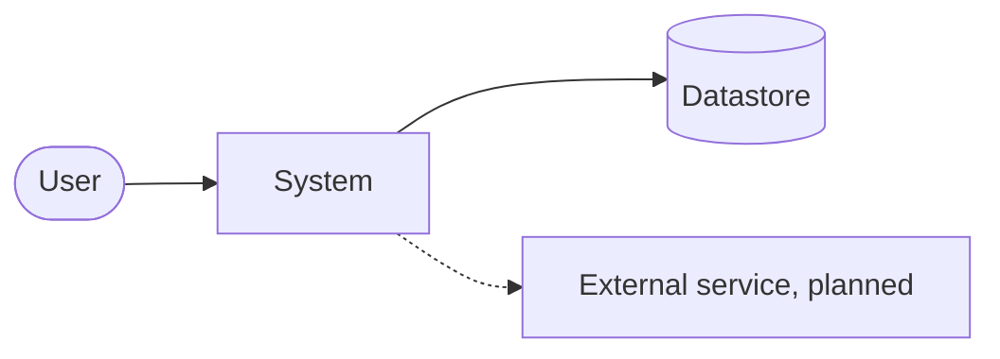
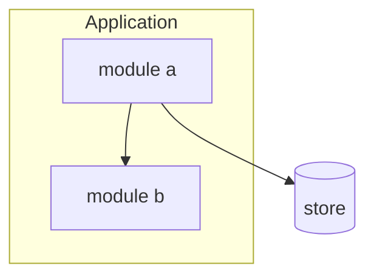
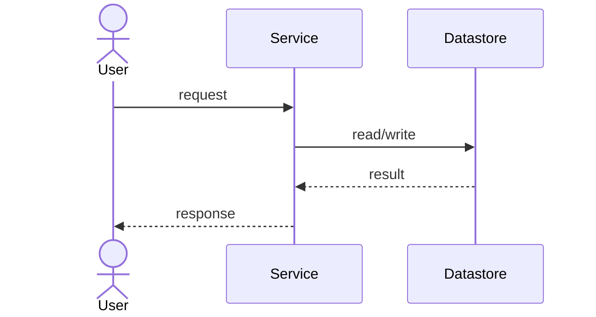
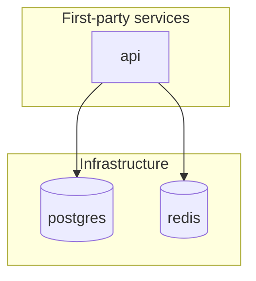

<!-- How to draw the architecture diagrams in the canonical SAD. Mermaid only. Every diagram is
     BUILT FROM the discovery evidence — never freehand. This keeps the diagrams honest: a node or
     edge appears only if a discovery artifact supports it. Read this before you write any diagram
     in docs/architecture.md. -->

# Architecture diagram conventions

## Format: Mermaid, inline
Write every diagram as a fenced ```mermaid block inside the Markdown. Do not use PlantUML, images,
or an external tool. Mermaid is text, versions in git, and renders in common viewers with no extra
tooling. Keep each diagram small enough to read — split a large one rather than crowd it.

## The honesty rule for diagrams
A diagram is evidence, not decoration. Build each one ONLY from the discovery artifacts. Do not add
a node or an edge that no artifact supports. Under each diagram, add one caption line naming the
source artifact(s). If the evidence is incomplete, draw what is supported and say so in the caption
(for example: "embed → embedding-service is planned, not wired — shown dashed").

## The five required diagrams and their evidence source

| SAD section | Diagram | Built from | Mermaid type |
|-------------|---------|------------|--------------|
| 4 System context | the system + external actors/neighbors | `_system/integration-map.md` (nodes + external_dependencies) | `flowchart LR` |
| 6.1 Logical / component | first-party modules + relationships | graphify graph (query/explain) + `structure-map.md` | `flowchart TB` |
| 6.2 Runtime | one key request flow | graphify `path` + `api-surface.md` | `sequenceDiagram` |
| 6.4 Deployment | services / containers / infra | `docker-compose.yml` + `integration-map.md` | `flowchart TB` with subgraphs |
| 6.5 Data | entities + relationships | per-service `data-model.md` | `erDiagram` |

## Conventions
- **Confidence in the drawing.** Draw an `observed` edge as a solid line (`-->`). Draw an
  `inferred` or planned-not-wired edge as a dashed line (`-.->`) and note it in the caption. This
  mirrors the evidence tags in the body.
- **Infra vs first-party.** In the deployment diagram, group first-party services and off-the-shelf
  infra (postgres/redis/minio/…) in separate `subgraph` blocks so the boundary is visible.
- **Labels.** Use the real node ids from the artifacts (service ids, module names, table names).
  Do not invent friendly names the code does not use.
- **Direction.** `LR` for context (few boxes, wide), `TB` for component/deployment (layered).
- **Keep it legible in both light and dark.** Do not rely on color to carry meaning — use line
  style (solid/dashed) and labels. Add a `%% comment` line citing the source artifact.
- **Avoid reserved words as entity/node ids.** In an `erDiagram`, `class` (and `CLASS`) is
  reserved and fails to parse. Prefix such names (`SCHOOL_CLASS`, `APP_USER`) and keep the real
  table name in the caption. Validate every diagram renders before you ship the document.

## Minimal templates (copy, then fill from evidence)

System context (`flowchart LR`):


Component / logical (`flowchart TB`):


Runtime (`sequenceDiagram`):


Deployment (`flowchart TB` + subgraphs):


Data (`erDiagram`):
```mermaid
erDiagram
  SCHOOL ||--o{ CLASS : has
  CLASS ||--o{ ENROLLMENT : has
  %% source: docs/discovery/<svc>/data-model.md
```
